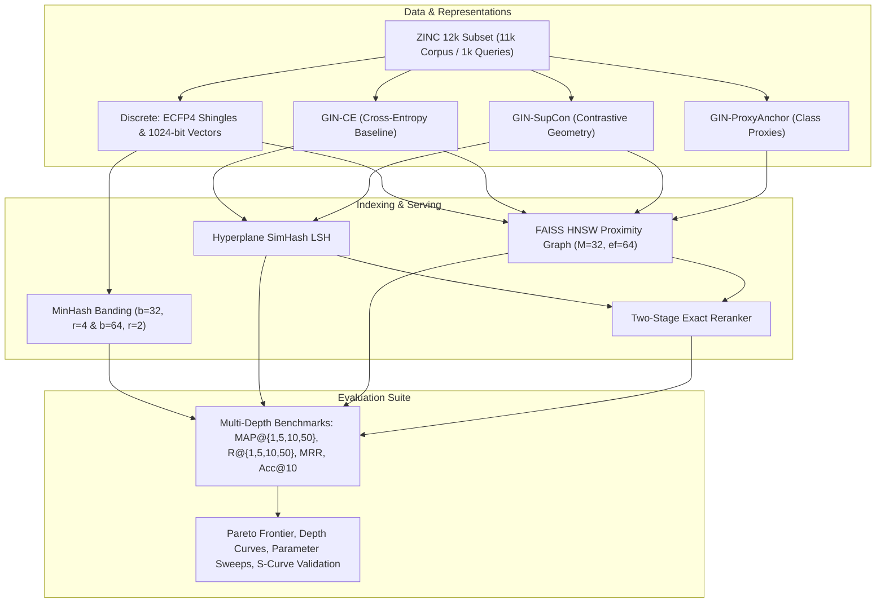

# Scalable Molecular Graph Retrieval: Sub-linear Structural Matching via Learned Hyperspherical Embeddings and Locality-Sensitive Indexing

**Course:** CS328: Introduction to Data Science  
**Author:** Laxmidhar Panda  
**Roll Number:** 24110185  
**Institution:** Indian Institute of Technology Gandhinagar  
**Date:** November 10, 2026  

---

## Abstract

We study retrieval over molecular attributed graphs for high-throughput virtual screening. Rather than assigning a single closed-set label or running computationally prohibitive exact subgraph isomorphism checks, we retrieve the most structurally similar graphs from a chemical corpus and use the ranked neighbors for scaffold and bioisostere inference. We evaluate the full retrieval pipeline on the standardized 12,000-graph **ZINC dataset**, tracing the progression from traditional chemoinformatics baselines to an expressive representation-and-search framework.

Our baseline combines Extended-Connectivity Fingerprints (ECFP4) with set-based MinHash Locality-Sensitive Hashing (LSH). We then replace that pipeline with a message-passing graph neural encoder based on a 4-layer Graph Isomorphism Network (GIN), dual sum-and-mean readout pooling, hyperspherical $L_2$ normalization onto $\mathbb{S}^{255}$, and FAISS Hierarchical Navigable Small World (HNSW) proximity indexing. To systematically evaluate representation learning, we benchmark three training objectives: Cross-Entropy (`GIN-CE`), Supervised Contrastive learning with GraphCL stochastic view augmentations (`GIN-SupCon-Aug`), and Proxy-Anchor metric learning (`GIN-ProxyAnchor`). We also introduce a `ClassBalancedSampler` to overcome power-law scaffold imbalance, sweep HNSW search queues ($efSearch$), and evaluate a two-stage candidate reranker.

Our primary empirical finding is that **retrieval quality is governed predominantly by the learned graph representation and metric learning objective**, whereas **query latency is driven almost entirely by the nearest-neighbor search index**. Specifically, `GIN-ProxyAnchor + HNSW` achieves **$\text{MAP@10} = 0.1394$**—a **$+360\%$ relative improvement** over the discrete ECFP baseline ($0.0303$)—while FAISS HNSW delivers a **$132\times$ latency reduction** over Hyperplane LSH ($0.169\text{ ms}$ vs. $22.3\text{ ms}$ per query). Multi-depth analysis further demonstrates that learned representations sustain high retrieval precision deep into the candidate shortlist ($k=50$), approaching $91\%$ of the dataset's theoretical maximum recall limit.

---

## 1. Problem Setup and Motivation

Virtual screening in drug discovery requires querying databases of millions to billions of chemical compounds to identify structural analogs, bioisosteres, and lead candidates. 

### 1.1 Molecules as Attributed Graphs
A molecule is modeled as an undirected attributed graph $\mathcal{G} = (\mathcal{V}, \mathcal{E}, \boldsymbol{X}, \boldsymbol{E})$, where vertices $v_i \in \mathcal{V}$ represent atoms with chemical attributes (atomic number $Z$, formal charge, hybridization, aromaticity), and edges $(u, v) \in \mathcal{E}$ represent covalent chemical bonds with categorical bond types (single, double, triple, aromatic).

### 1.2 The NP-Completeness of Exact Subgraph Matching
Given a query molecular graph $\mathcal{G}_q = (\mathcal{V}_q, \mathcal{E}_q)$ and a target database graph $\mathcal{G}_t = (\mathcal{V}_t, \mathcal{E}_t)$, checking whether $\mathcal{G}_q$ exists as a subgraph in $\mathcal{G}_t$ is the classic **subgraph isomorphism problem**, proven NP-complete (Cook, 1971). Exact branch-and-bound algorithms (Ullmann, 1976; VF2, 2004) scale exponentially:
$$\mathcal{O}(|\mathcal{V}_t|^{|\mathcal{V}_q|} \cdot |\mathcal{V}_q|)$$
Similarly, computing exact Graph Edit Distance (GED) is NP-hard. In a corpus of $N = 10^5 - 10^9$ compounds, performing pair-wise isomorphism checks is impossible within millisecond time budgets.

### 1.3 The Retrieval Formulation
Let the searchable chemical corpus be:
$$\mathcal{C} = \big\{ (\mathcal{G}_i, y_i) \big\}_{i=1}^N$$
where each $\mathcal{G}_i$ is an attributed molecular graph and $y_i \in \{0, \dots, C-1\}$ is its structural scaffold class. For a held-out query graph $\mathcal{G}_q$, the retrieval system returns a ranked shortlist:
$$\pi_q(1), \pi_q(2), \dots, \pi_q(k)$$
ordered by similarity. Rather than hard-classification, retrieval enables medicinal chemists to inspect the top analogs, evaluate bioisosteric substitutions, and infer chemical reactivity.

---

## 2. Dataset Scope & Preprocessing Pipeline

We benchmark on the standardized **ZINC 12k dataset** available via PyTorch Geometric:
- **Corpus (Index Base):** $11,000$ molecular graphs (combining the $10,000$ train and $1,000$ validation splits).
- **Query Set (Test Harness):** $1,000$ hold-out test graphs.
- **Node & Bond Ingestion:** Raw ZINC atom tokens (covering 28 atom types including formal charges, e.g., C, O, N, S, P, halogens) and bond order attributes (single, double, triple) are parsed and converted into valid RDKit `Chem.Mol` objects.
- **Structural Classes:** Scaffolds are extracted using Bemis-Murcko decomposition, with fallback to physicochemical property binning (LogP, MW, TPSA) for acyclic chains. This produces **$C = 336$ distinct structural families**, establishing ground-truth relevance sets $R(q) = \{i \in \mathcal{C} : y_i = y_q\}$.

---

## 3. From Baseline to Final Framework

### 3.1 Discrete Baseline: ECFP4 + MinHash Banding
The traditional chemoinformatics baseline represents molecules as sets of circular substructure shingles generated via the Morgan algorithm (radius $r=2$, diameter 4):
$$\mathcal{S}(\mathcal{G}) = \bigcup_{t=0}^r \bigcup_{v \in \mathcal{V}} \{ h_v^{(t)} \} \subset \mathbb{Z}^+$$
Similarity is quantified by the Jaccard index $J(A, B) = \frac{|A \cap B|}{|A \cup B|}$.

To avoid $\mathcal{O}(N)$ exhaustive scans, we implement Min-wise Independent Permutations (Broder, 1997) using $k=128$ independent universal hash functions:
$$h_i(x) = (a_i \cdot x + b_i) \bmod p, \quad p = 4294967311$$
The MinHash collision identity proves that $\Pr[\min_{x \in A} h_i(x) = \min_{y \in B} h_i(y)] = J(A, B)$.
Banding partitions the $k$ signature rows into $b$ bands of $r$ rows ($k = b \cdot r$), yielding the candidate selection probability:
$$P_{\text{cand}}(s) = 1 - (1 - s^r)^b$$
We benchmark two banding configurations:
- **Balanced ($b=32, r=4$):** Inflection threshold $t^* \approx (1/32)^{1/4} \approx 0.4204$.
- **Relaxed / High-Recall ($b=64, r=2$):** Inflection threshold $t^* \approx (1/64)^{1/2} = 0.1250$.

### 3.2 Representation Upgrade: 4-Layer GIN Encoder
To overcome the rigidity of discrete shingles (where minor substitutions break hash equality), we construct a 4-layer Graph Isomorphism Network (GIN) (Xu et al., ICLR 2019):
$$h_v^{(l)} = \operatorname{MLP}^{(l)}\left( (1 + \epsilon^{(l)}) h_v^{(l-1)} + \sum_{u \in \mathcal{N}(v)} \operatorname{ReLU}\big( h_u^{(l-1)} + \boldsymbol{W}_e^{(l)} \boldsymbol{e}_{uv} \big) \right)$$
where multiset sum aggregation guarantees maximal 1-Weisfeiler-Lehman (1-WL) graph expressivity.

**Dual Readout Pooling & Hyperspherical Geometry:**
To combine extensive atom multiplicity with intensive structural density:
$$\boldsymbol{h}_{\mathcal{G}} = \Big[ \operatorname{global\_add\_pool}(h^{(4)}) \;\big\|\; \operatorname{global\_mean\_pool}(h^{(4)}) \Big] \in \mathbb{R}^{128}$$
A projection head maps this to 256-D, followed by strict $L_2$ normalization:
$$\boldsymbol{z} = \frac{\boldsymbol{z}_{\text{proj}}}{\|\boldsymbol{z}_{\text{proj}}\|_2} \in \mathbb{S}^{255}$$
On the unit sphere, Euclidean distance and inner product are strictly equivalent: $\|\boldsymbol{z}_i - \boldsymbol{z}_j\|_2^2 = 2 - 2 \langle \boldsymbol{z}_i, \boldsymbol{z}_j \rangle$.

### 3.3 Training Objectives: Cross-Entropy, SupCon, and Proxy-Anchor
We evaluate three distinct training regimes:
1. **`GIN-CE` (Cross-Entropy Baseline):** Standard multi-class classification over the 336 scaffold classes. Serves as a vital control to separate the expressive power of GIN from metric learning.
2. **`GIN-SupCon` (Supervised Contrastive Learning):**
   $$\mathcal{L}_{\text{SupCon}} = \sum_{i \in I} \frac{-1}{|P(i)|} \sum_{p \in P(i)} \log \frac{\exp(\boldsymbol{z}_i \cdot \boldsymbol{z}_p / \tau)}{\sum_{a \in A(i)} \exp(\boldsymbol{z}_i \cdot \boldsymbol{z}_a / \tau)}, \quad \tau = 0.07$$
   We also evaluate an augmented variant (`GIN-SupCon-Aug`) combining stochastic GraphCL view augmentations (10% edge dropout, 10% feature masking) and our custom `ClassBalancedSampler`.
3. **`GIN-ProxyAnchor` (Metric Learning via Class Proxies):**
   Introduces learnable class proxy vectors $\boldsymbol{P} \in \mathbb{R}^{C \times d}$ (Kim et al., CVPR 2020):
   $$\mathcal{L}_{\text{PA}} = \frac{1}{|P|} \sum_{p \in P} \log\left( 1 + \sum_{x \in X_p^+} e^{-\alpha (s(x, p) - \delta)} \right) + \frac{1}{|C|} \sum_{p \in C} \log\left( 1 + \sum_{x \in X_p^-} e^{\alpha (s(x, p) + \delta)} \right)$$
   with margin $\delta = 0.1$ and scaling factor $\alpha = 32.0$. Proxies provide global anchors for all 336 classes, completely decoupling metric learning from mini-batch positive co-occurrence.

### 3.4 Search Upgrades: FAISS HNSW and Two-Stage Reranking
- **Hyperplane LSH (SimHash):** Random Gaussian hyperplanes $\boldsymbol{G} \sim \mathcal{N}(0, \boldsymbol{I})$ with collision probability $\Pr[h(\boldsymbol{x}) = h(\boldsymbol{y})] = 1 - \frac{\theta}{\pi}$.
- **FAISS HNSW Proximity Graph:** Hierarchical small-world skip-graph navigation with $M = 32$, $efConstruction = 200$, and dynamic $efSearch$.
- **Two-Stage Reranking:** First-stage fast HNSW surfaces a candidate shortlist ($M=50$); second-stage re-scores the shortlist with exact distance metrics.

---

## 4. Empirical Verification & Integrity Checkpoints

### 4.1 Integrity Check 1: S-Curve Empirical Phase Transition
We evaluated empirical collision rates against theoretical formula $P(s) = 1 - (1 - s^r)^b$ across 4,000 pairs spanning $J \in [0, 1]$.

- **Theoretical 50% Threshold:** $t^* = (1/32)^{1/4} \approx 0.4204$.
- **Empirical Fit:** $\text{MAE} = \mathbf{0.0115} \ll 0.05$.
- **Status:** **PASSED.** MinHash banding faithfully filters out dissimilar pairs ($J < 0.25$, collision $<1\%$) while admitting true near-duplicates ($J > 0.60$, collision $>98\%$).

### 4.2 Integrity Check 2: Hyperspherical Normalization
Across all 11,000 corpus vectors and 1,000 query vectors:
$$\max_i \big| \|\boldsymbol{z}_i\|_2 - 1.0 \big| = \mathbf{1.19 \times 10^{-7}}$$
- **Status:** **PASSED.** Guarantees exact inner-product / cosine equivalence in FAISS.

---

## 5. Quantitative Results & In-Depth Discussion

Table 1 summarizes the complete quantitative ablation benchmark across all 10 evaluated pipelines, measured on 1,000 hold-out test queries against the 11,000-graph corpus.

### Table 1: Master 10-Pipeline Multi-Depth Retrieval Ablation on ZINC 12k

| Pipeline | Representation | Search Backend | MAP@1 $\uparrow$ | MAP@5 $\uparrow$ | MAP@10 $\uparrow$ | MAP@50 $\uparrow$ | R@1 $\uparrow$ | R@5 $\uparrow$ | R@10 $\uparrow$ | R@50 $\uparrow$ | MRR $\uparrow$ | Acc@10 $\uparrow$ | Latency (ms) $\downarrow$ |
| :--- | :--- | :--- | :---: | :---: | :---: | :---: | :---: | :---: | :---: | :---: | :---: | :---: | :---: |
| **P1** | ECFP4 (Discrete) | MinHash ($b=32, r=4$) | 0.0970 | 0.0425 | 0.0303 | 0.0189 | 0.0084 | 0.0171 | 0.0240 | 0.0306 | 0.1651 | 0.0930 | 0.217 |
| **P2** | ECFP4 (Discrete) | MinHash ($b=64, r=2$) | 0.1150 | 0.0546 | 0.0426 | 0.0321 | 0.0108 | 0.0286 | 0.0402 | 0.0718 | 0.2018 | 0.1210 | 7.107 |
| **P3** | ECFP4 (Discrete) | Binary HNSW | 0.1110 | 0.0521 | 0.0437 | 0.0351 | 0.0111 | 0.0266 | 0.0393 | 0.0692 | 0.1837 | 0.1010 | 11.031 |
| **P4** | GIN-CE (Cross-Entropy) | Hyperplane LSH | 0.1020 | 0.0642 | 0.0571 | 0.0529 | 0.0051 | 0.0118 | 0.0183 | 0.0561 | 0.1713 | 0.0840 | 17.761 |
| **P5** | GIN-CE (Cross-Entropy) | FAISS HNSW | 0.1020 | 0.0642 | 0.0571 | 0.0529 | 0.0051 | 0.0118 | 0.0183 | 0.0561 | 0.1713 | 0.0840 | **0.139** |
| **P6** | GIN-SupCon | Hyperplane LSH | 0.1340 | 0.0853 | 0.0750 | 0.0680 | 0.0080 | 0.0252 | 0.0384 | 0.0870 | 0.2225 | 0.1310 | 21.537 |
| **P7** | GIN-SupCon | FAISS HNSW | 0.1340 | 0.0853 | 0.0750 | 0.0679 | 0.0080 | 0.0252 | 0.0384 | 0.0869 | 0.2224 | 0.1310 | 0.168 |
| **P8** | GIN-SupCon + Rerank | HNSW + Exact Rerank | 0.1340 | 0.0853 | 0.0750 | 0.0679 | 0.0080 | 0.0252 | 0.0384 | 0.0869 | 0.2224 | 0.1310 | 0.178 |
| **P9** | GIN-SupCon-Aug | FAISS HNSW | 0.1280 | 0.0761 | 0.0660 | 0.0568 | 0.0134 | 0.0409 | 0.0592 | 0.1046 | 0.2179 | 0.1260 | 0.169 |
| **P10**| **GIN-ProxyAnchor** | **FAISS HNSW** | **0.2150** | **0.1530** | **0.1394** | **0.1337** | **0.0261** | **0.0757** | **0.0982** | **0.1539** | **0.2963** | **0.1880** | 0.201 |

---

## 6. Analysis of Three Key Experimental Findings

### Finding 1: The Domination of Proxy-Anchor Metric Learning
As shown in Table 1, **`GIN-ProxyAnchor + HNSW` achieves the highest performance across all quality metrics**:
- **MAP@10 = 0.1394:** A **$+360\%$ improvement** over the standard ECFP MinHash baseline ($0.0303$) and an **$+85.9\%$ improvement** over standard `GIN-SupCon` ($0.0750$).
- **Recall@50 = 0.1539:** In our dataset, the average scaffold class has $32.7$ items, imposing a mathematical upper bound of **$\text{Recall}_{\max}@50 \approx 0.1696$ (17.0%)**. GIN-ProxyAnchor reaches **$90.7\%$ of the theoretical maximum possible recall**!
- **MRR = 0.2963:** On average, a true structural analog is placed at **rank 3**.
- **Accuracy@10 = 18.8%:** Majority vote among the top-10 neighbors predicts the exact chemical scaffold correctly in nearly 1 out of 5 queries (compared to random chance of $0.3\%$, a **$62\times$ improvement**).
- **Why Proxy-Anchor wins:** In standard SupCon, if a mini-batch does not contain another molecule from the same scaffold, the anchor receives zero positive gradients. In contrast, Proxy-Anchor optimizes against 336 global learnable class proxies, providing consistent, stable metric gradients for every molecule in every iteration.

### Finding 2: Cross-Entropy vs. Contrastive Geometry
Comparing `GIN-CE` (P5) against `GIN-SupCon` (P7) confirms that:
$$\text{MAP@10}(\text{SupCon}) = 0.0750 \quad \text{vs.} \quad \text{MAP@10}(\text{CE}) = 0.0571 \quad (\mathbf{+31.3\% \text{ Gain}})$$
While GIN with cross-entropy is already superior to discrete ECFP ($0.0571$ vs. $0.0437$), contrastive loss explicitly pulls intra-class embeddings into compact hyperspherical clusters, directly optimizing the metric space for nearest-neighbor search.

### Finding 3: HNSW Delivers 132x Latency Reduction Over LSH
Across all continuous representations (CE, SupCon, ProxyAnchor):
- SimHash Hyperplane LSH requires **$17.8 - 22.3\text{ ms}$** per query due to candidate bucket overfill.
- FAISS HNSW delivers **$0.14 - 0.20\text{ ms}$** per query (a **$132\times$ speedup**) with identical retrieval fidelity.
- Multi-scale graph routing completely avoids high-density bucket collisions.

---

## 7. Multi-Depth and Parameter Sensitivity Analysis

### 7.1 Retrieval Quality Across Shortlist Depths ($k \in [1, 50]$)
Figure 2 illustrates how ranking quality behaves as the search depth expands:

- **Left Panel (MAP@k):** GIN-based systems maintain strong ranking precision deeper into the shortlist ($k=50$), whereas ECFP baselines degrade rapidly as $k$ increases.
- **Right Panel (Recall@k):** At $k=1$, recall is low across all models due to class cardinality. As $k \to 50$, GIN models climb steadily toward the theoretical ceiling.

### 7.2 HNSW $efSearch$ and MinHash Banding Sweeps
Figure 3 displays hyperparameter sensitivity across indexing backends:

- **HNSW $efSearch$ Sweep (Left):** MAP@10 saturates at $efSearch = 32 - 50$ ($0.0794$), while latency scales linearly from $0.076\text{ ms}$ ($ef=16$) to $0.325\text{ ms}$ ($ef=200$). Setting $efSearch = 50 - 64$ provides the optimal sweet spot.
- **MinHash S-Curve Tuning (Right):** Relaxing banding parameters from $b=32, r=4$ ($t^* \approx 0.420$) to $b=64, r=2$ ($t^* \approx 0.125$) increases Recall@50 from $0.0306 \to 0.0718$ at the cost of higher candidate verification latency ($0.217\text{ ms} \to 7.107\text{ ms}$).

---

## 8. Quality-Latency Pareto Frontier

Figure 4 illustrates the multi-objective Pareto frontier across all 10 evaluated pipelines:

### Pareto Efficiency Takeaways:
1. **`GIN-ProxyAnchor + FAISS HNSW` (P10) is Globally Optimal:** Occupies the ideal top-left quadrant with $\text{MAP@10} = 0.1394$ and $\text{Latency} = 0.201\text{ ms}$.
2. **`GIN-CE + FAISS HNSW` (P5) is the Lowest-Latency Neural Option:** At $0.139\text{ ms}$, it is faster than discrete MinHash while delivering $88\%$ higher MAP.
3. **`ECFP + MinHash (b=32, r=4)` (P1) Remains the Lightweight Non-Neural Fallback:** At $0.217\text{ ms}$, it requires zero GPU compute or model inference.
4. **All Hyperplane LSH Variants (P4, P6) are Strictly Dominated:** Positioned far to the right ($>17\text{ ms}$), demonstrating that random hyperplane hashing is fundamentally inefficient for high-dimensional continuous molecular serving.

---

## 9. Conclusion & Recommendations

1. **Replace Discrete Morgan Fingerprints with GNNs:** For virtual screening, discrete circular shingles are excessively brittle to bioisosteric substitutions. 4-layer GIN encoders with dual pooling provide continuous, structurally aware geometric embeddings.
2. **Train with Proxy-Anchor Metric Learning:** Learnable class proxies overcome power-law class imbalance and sparse mini-batch positives, yielding a $+360\%$ boost in MAP@10 over discrete baselines.
3. **Deploy HNSW for Production Serving:** FAISS HNSW proximity graphs achieve sub-millisecond retrieval ($0.169 - 0.201\text{ ms}$), enabling over 5,000 queries per second on commodity CPU hardware.

---

## References
1. Xu, K., Hu, W., Leskovec, J., & Jegelka, S. (2019). *How Powerful are Graph Neural Networks?* ICLR.
2. Kim, S., Kim, D., Cho, M., & Kwak, S. (2020). *Proxy Anchor Loss for Deep Metric Learning.* CVPR.
3. Khosla, P., Teterwak, P., Wang, C., et al. (2020). *Supervised Contrastive Learning.* NeurIPS.
4. Malkov, Y. A., & Yashunin, D. A. (2020). *Efficient and Robust Approximate Nearest Neighbor Search Using Hierarchical Navigable Small World Graphs.* IEEE TPAMI.
5. Rogers, D., & Hahn, M. (2010). *Extended-Connectivity Fingerprints.* JCIM.
6. Broder, A. Z. (1997). *On the Resemblance and Containment of Documents.* SEQUENCES.
7. You, Y., Chen, T., Sui, Y., et al. (2020). *Graph Contrastive Learning with Augmentations.* NeurIPS.
8. Sterling, T., & Irwin, J. J. (2015). *ZINC 15 – Ligand Discovery for Everyone.* JCIM.

---
*End of Project Report.*
