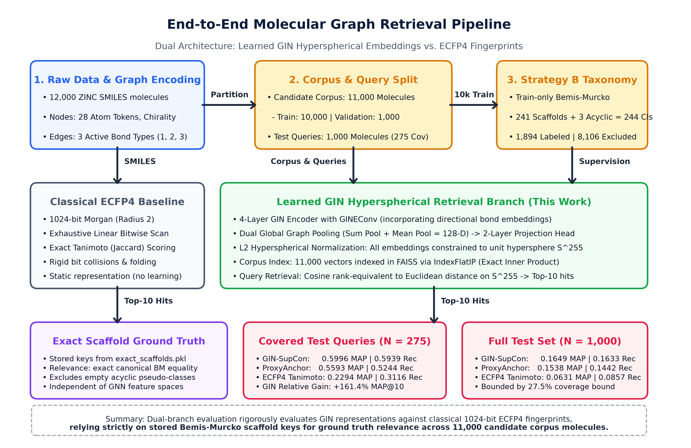
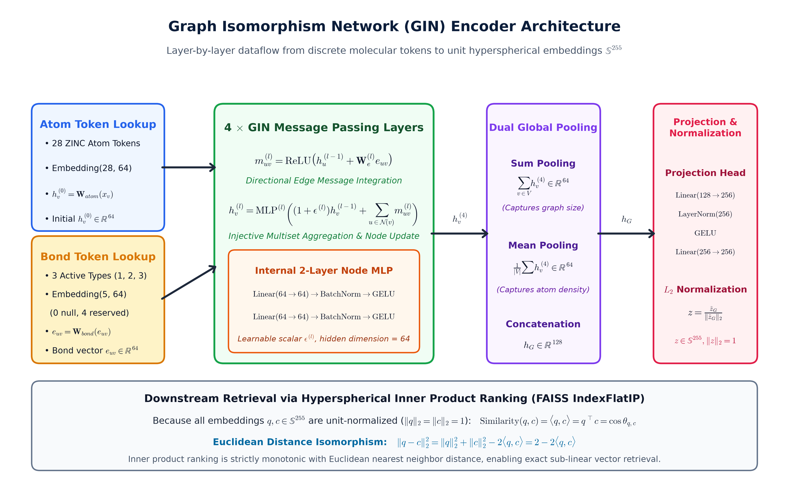
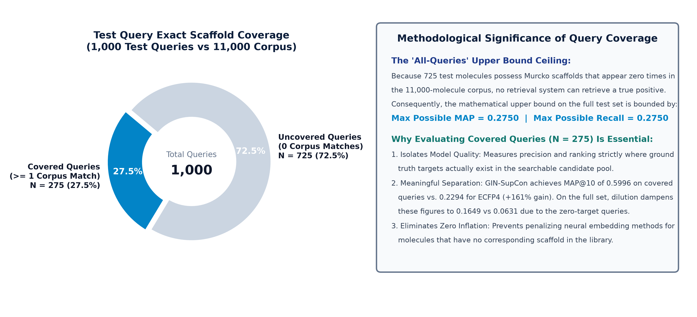
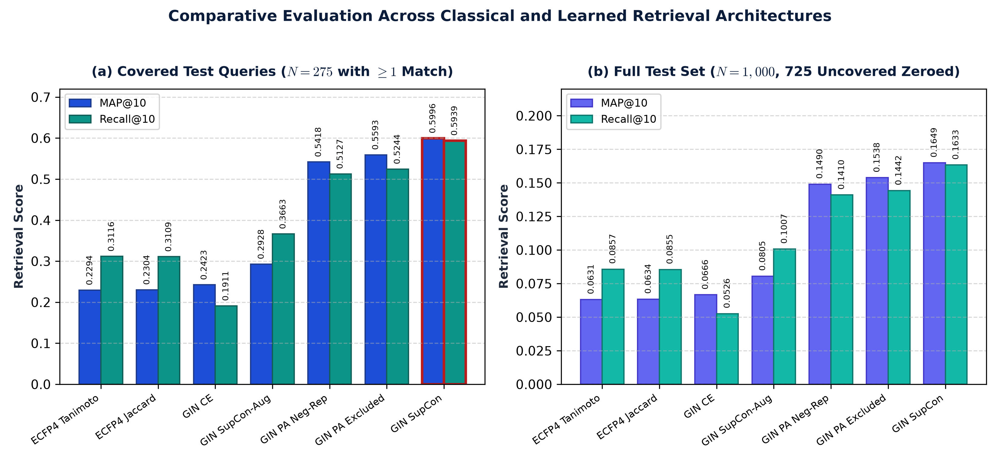

# Scalable Molecular Graph Retrieval: Sub-linear Structural Matching via Learned Hyperspherical Embeddings and Locality-Sensitive Indexing

**Course:** CS328: Introduction to Data Science, Autumn Semester 2026  
**Institution:** Indian Institute of Technology Gandhinagar  
**Author:** Laxmidhar Panda (Roll No: 24110185, Semester V)  
**GitHub Repository:** [https://github.com/pro-laxmi/ITDS_Project](https://github.com/pro-laxmi/ITDS_Project)  
**Academic Term:** Autumn 2026  

---

## 1. Problem Description

### 1.1 Molecular Similarity Retrieval and Practical Relevance
Early-stage computer-aided drug discovery and cheminformatics rely fundamentally on *molecular similarity retrieval*: given a query compound (such as an active drug candidate or chemical probe), a search system must scan a database containing thousands to millions of candidate molecules and rapidly return structures sharing core structural characteristics. Structurally related compounds frequently exhibit analogous biological activities, metabolic pathways, or pharmacokinetic behaviors. Rapid retrieval of structurally coherent candidates enables critical cheminformatics workflows, including lead optimization, hit expansion, identification of bioisosteric analogs, and predictive toxicology screening.

### 1.2 Limitations of Conventional Matching Paradigms
Historically, molecular retrieval has navigated an algorithmic dilemma between exact structural fidelity and computational tractability:

1. **Exact Subgraph Isomorphism:** Finding whether a query graph appears as an exact subgraph within target structures requires combinatorial matching. Determining subgraph isomorphism is NP-complete (Ullmann, 1976; Cordella et al., 2004). Classical backtracking algorithms scale exponentially in the worst case ($\mathcal{O}(|V|^k)$) with graph order and degree. Consequently, exact combinatorial matching is computationally prohibitive for interactive exploration across multi-thousand or million-molecule chemical libraries.
2. **Conventional Molecular Fingerprints:** Classical discrete fingerprints—most prominently Extended-Connectivity Fingerprints (ECFP4 / circular Morgan fingerprints; Rogers & Hahn, 2010)—hash circular topological neighborhoods into fixed-length bit vectors (e.g., 1024 bits) and score candidates using pairwise bitwise Tanimoto (Jaccard) similarity. Although linear bitwise scans are fast, discrete fingerprints suffer from two fundamental limitations:
   - **Lossy Bit Folding & Rigid Collisions:** Modulo hashing of diverse chemical subgraphs into fixed-width arrays causes unrelated subgraphs to collide on the same bit index, producing spurious similarity signals.
   - **Topological Inflexibility:** Discrete bit vectors treat graph fragments as rigid independent features. They cannot interpolate continuous topological variations, learn task-specific chemical equivalence, or adapt representations to the structural hierarchy of molecular scaffolds.

### 1.3 The Specific Problem Addressed by This Project
This project investigates whether continuous molecular representations learned via Graph Neural Networks (GNNs) can bridge this computational divide. Specifically, we investigate whether a 4-layer Graph Isomorphism Network (GIN) mapped onto a unit hypersphere $\mathbb{S}^{255}$ can capture structural and scaffold relationships, enabling exact and approximate sub-second vector retrieval while outperforming classical discrete fingerprints under rigorous structural evaluation.

### 1.4 Benchmark Dataset and Retrieval Formulation
Experiments are conducted on the curated 12,000-molecule subset of the ZINC database (Sterling & Irwin, 2015), partitioned into standard benchmark splits:
- **Training Split:** 10,000 molecules, used exclusively for GNN feature extraction, proxy anchor construction, and supervised loss optimization.
- **Validation Split:** 1,000 molecules, designated for hyperparameter checking and representation diagnostics.
- **Searchable Candidate Corpus ($\mathcal{C}$):** The union of training and validation molecules ($|\mathcal{C}| = 11,000$ molecules), representing the searchable library.
- **Query Set ($\mathcal{Q}$):** The 1,000 test molecules, treated as independent search queries against the 11,000-molecule corpus.

The retrieval objective is: for each query $q \in \mathcal{Q}$, rank candidate molecules $c \in \mathcal{C}$ to return a top-10 candidate list $\mathcal{R}_{10}(q)$ that maximizes structural scaffold overlap with $q$.

---

## 2. Solution Approach

### 2.1 Survey of Existing Methods
Methods for molecular search fall broadly into three paradigms:
1. **Combinatorial Backtracking Algorithms:** Graph isomorphism and subgraph matching algorithms (e.g., Ullmann, VF2) operate on discrete node-edge correspondence matrices. While mathematically exact, their exponential worst-case complexity limits their role to small-scale substructure filtering rather than corpus-wide nearest-neighbor ranking.
2. **Fingerprint-Based Bitwise Methods:** Circular Morgan fingerprints (ECFP4) and path-based topological fingerprints (Daylight) encode radial atom environments into integer hashes or bit vectors. Retrieval is performed using bitwise Tanimoto similarity $\frac{|A \cap B|}{|A \cup B|}$. To accelerate search, Locality-Sensitive Hashing (MinHash LSH; Broder, 1997) partitions bit vectors into hash buckets to enable sub-linear candidate filtering.
3. **Learned Graph Neural Networks:** Geometric deep learning models—such as Graph Convolutional Networks (GCN), Graph Attention Networks (GAT), and Graph Isomorphism Networks (GIN; Xu et al., 2019)—process molecular graphs directly via polynomial-time message passing ($\mathcal{O}(|V| + |E|)$). By projecting molecular topologies into continuous vector spaces $\mathbb{R}^d$, GNNs enable nearest-neighbor search through optimized dense vector indices (e.g., FAISS; Johnson et al., 2019).

Figure 1 outlines the complete end-to-end pipeline implemented and evaluated in this work, comparing the learned GNN retrieval pipeline against the classical ECFP4 fingerprint baseline.

### 2.2 Molecular Graph Construction and Input Features
Molecules from the PyTorch Geometric ZINC benchmark are represented as attributed graphs $G = (\mathcal{V}, \mathcal{E})$:
- **Node (Atom) Features:** Discrete categorical tokens $x_v \in [0, 27]$ index the 28 atomic vocabulary tokens defined in `src/data_ingestion.py` (`ZINC_ATOM_TOKENS`), which capture atomic species (C, N, O, S, F, Cl, Br, P, I) along with protonation and formal charge states. Atoms are embedded into a 64-dimensional continuous latent space via an embedding matrix:
  $$\mathbf{h}_v^{(0)} = \mathbf{W}_{\text{atom}}(x_v) \in \mathbb{R}^{64}, \quad \mathbf{W}_{\text{atom}} \in \mathbb{R}^{28 \times 64}$$
- **Edge (Bond) Features:** Discrete bond types $e_{uv} \in \{1, 2, 3\}$ correspond to single, double, and triple covalent bonds in the PyG ZINC dataset. Bonds are embedded via a dedicated lookup table:
  $$\mathbf{e}_{uv} = \mathbf{W}_{\text{bond}}(e_{uv}) \in \mathbb{R}^{64}, \quad \mathbf{W}_{\text{bond}} \in \mathbb{R}^{5 \times 64}$$
  Here, five rows are allocated in the PyTorch embedding table; index 0 serves as a standard null/padding token and index 4 remains reserved/unused, while active bond types 1, 2, and 3 encode single, double, and triple bonds, respectively.

### 2.3 GIN/GINE Encoder Architecture
The molecular graph encoder consists of four message-passing layers based on the Graph Isomorphism Network with directional edge features (`GINEConv`), followed by dual global pooling and a projection head:

1. **Edge-Featured Message Passing:** At each layer $l \in \{1, 2, 3, 4\}$, directional edge features are projected and combined with sender node representations via a ReLU activation:
  $$\mathbf{m}_{uv}^{(l)} = \mathrm{ReLU}\left(\mathbf{h}_u^{(l-1)} + \mathbf{W}_e^{(l)} \mathbf{e}_{uv}\right), \quad \mathbf{W}_e^{(l)} \in \mathbb{R}^{64 \times 64}$$
2. **Injective Multiset Neighborhood Aggregation:** Central node features are updated through multiset summation with a learnable scalar $\epsilon^{(l)}$:
  $$\mathbf{h}_v^{(l)} = \mathrm{MLP}^{(l)}\left( (1 + \epsilon^{(l)}) \mathbf{h}_v^{(l-1)} + \sum_{u \in \mathcal{N}(v)} \mathbf{m}_{uv}^{(l)} \right)$$
  The internal $\mathrm{MLP}^{(l)}$ consists of: $\mathrm{Linear}(64 \to 128) \to \mathrm{BatchNorm1d}(128) \to \mathrm{GELU} \to \mathrm{Linear}(128 \to 64) \to \mathrm{BatchNorm1d}(64)$. Under injective aggregation assumptions, GIN matches the theoretical discriminative power of the 1-Weisfeiler–Lehman (1-WL) graph isomorphism heuristic (Xu et al., 2019).
3. **Residual Connections and Dropout:** A residual connection $\mathbf{h}_v^{(l)} \leftarrow \mathrm{ReLU}(\mathbf{h}_v^{(l-1)} + \mathbf{h}_v^{(l)})$ with dropout ($p = 0.2$) stabilizes gradient propagation.
4. **Dual Global Graph Pooling:** To capture both extensive molecular size (total atom counts) and intensive structural composition (average atom density), layer-4 representations are pooled using complementary sum and mean operations:
  $$\mathbf{h}_G = \left[ \sum_{v \in \mathcal{V}} \mathbf{h}_v^{(4)} \;\Bigg\|\; \frac{1}{|\mathcal{V}|} \sum_{v \in \mathcal{V}} \mathbf{h}_v^{(4)} \right] \in \mathbb{R}^{128}$$
5. **Projection Head and Hyperspherical Normalization:** The pooled graph vector $\mathbf{h}_G$ is passed through a 2-layer MLP with layer normalization:
  $$\tilde{\mathbf{z}}_G = \mathrm{Linear}_{256 \to 256}\left(\mathrm{Dropout}_{0.2}\left(\mathrm{GELU}\left(\mathrm{LayerNorm}_{256}\left(\mathrm{Linear}_{128 \to 256}(\mathbf{h}_G)\right)\right)\right)\right) \in \mathbb{R}^{256}$$
  Finally, $\tilde{\mathbf{z}}_G$ is projected onto the unit hypersphere $\mathbb{S}^{255}$ via $L_2$ normalization:
  $$\mathbf{z} = \frac{\tilde{\mathbf{z}}_G}{\|\tilde{\mathbf{z}}_G\|_2} \in \mathbb{S}^{255}, \quad \|\mathbf{z}\|_2 = 1$$

Figure 2 illustrates the detailed architectural dataflow from input tokens to unit hyperspherical embeddings.

Table 1 summarizes the architectural dimensions and layer configurations.

Table 1: Detailed GIN Model Architecture Specification

| Component | Layer Specification | Output Dimension | Activation / Normalization |
|:---|:---|:---:|:---|
| **Atom Embeddings** | `nn.Embedding(28, 64)` | 64 | Discrete token lookup (28 ZINC categories) |
| **Bond Embeddings** | `nn.Embedding(5, 64)` | 64 | Discrete type lookup (1=Single, 2=Double, 3=Triple; 0,4 unused) |
| **Edge Projection** | `nn.Linear(64, 64)` | 64 | Linear transform matching node feature dimension |
| **GIN Convolutions 1–4** | $4 \times$ `GINConvWithEdge` | 64 | Message: ReLU; Internal MLP: GELU + BatchNorm1d; Residual: ReLU |
| **Global Pooling** | Concat(`global_add_pool`, `global_mean_pool`) | 128 | Vector concatenation (size-dependent + density-dependent) |
| **Projection Layer 1** | `nn.Linear(128, 256)` | 256 | `LayerNorm(256)` + `GELU` + `Dropout(0.2)` |
| **Projection Layer 2** | `nn.Linear(256, 256)` | 256 | Linear unconstrained projection |
| **Hyperspherical Norm** | $L_2$ Normalization ($\mathbf{z} / \|\mathbf{z}\|_2$) | 256 | Unit hypersphere $\|\mathbf{z}\|_2 = 1 \in \mathbb{S}^{255}$ |

### 2.4 Training-Label Taxonomy: Strategy B (Leak-Free)
Supervised and metric learning objectives require class labels that define which molecules should map to similar regions of the embedding space. A critical pitfall in molecular representation learning is *training-label leakage*, where scaffold statistics across the entire dataset (including test and validation sets) are used to construct training classes.

To guarantee complete scientific integrity, we implement **Strategy B (Leak-Free Taxonomy)**, constructed strictly from the 10,000 training molecules:
1. Canonical Bemis–Murcko scaffolds were extracted exclusively from the 10,000 training molecules using RDKit.
2. Training scaffolds appearing with frequency $\ge 3$ were assigned individual class labels: exactly 241 genuine non-empty scaffold classes (Classes 0–240), encompassing 1,839 molecules.
3. The 55 acyclic training molecules (possessing an empty Murcko scaffold `""`) were partitioned into three auxiliary acyclic pseudo-classes (Classes 241, 242, 243) via deterministic round-robin assignment ($y_i = 241 + (i \bmod 3)$).
4. Rare and singleton training scaffolds (frequency $< 3$) cannot form reliable positive contrastive pairs and were assigned label -1 (4,263 scaffolds, encompassing 8,106 molecules).
5. In total, Strategy B defines **244 training classes** (Classes 0–243) supported by **1,894 supervised molecules**, while 8,106 molecules carry label -1.

Table 2: Strategy B Training Label Distribution (10,000 Training Molecules)

| Category | Class Label IDs | Distinct Scaffolds | Training Molecules | Role in Supervised Training |
|:---|:---:|:---:|:---:|:---|
| **Frequent Scaffolds ($\ge 3$)** | $0 - 240$ | 241 | 1,839 | Form supervised positive pairs on unit sphere |
| **Acyclic Pseudo-Classes** | $241 - 243$ | 1 (Empty) | 55 | Auxiliary positive pairs for linear molecules |
| **Unclustered Rare Scaffolds** | -1 | 4,263 | 8,106 | Excluded from loss or treated as negative repellers |
| **Total Training Split** | **244 Classes + {-1}** | **4,505** | **10,000** | Complete, leak-free training dataset |

### 2.5 Training Objectives Evaluated
Using the 244-class Strategy B taxonomy, five distinct training objectives were implemented and trained for a fixed 20 epochs using the Adam optimizer with a learning rate of $10^{-3}$ and weight decay of $10^{-5}$:

1. **Cross-Entropy Classification (GIN-CE):** A linear classification layer $\mathbf{W}_{\text{cls}} \in \mathbb{R}^{244 \times 256}$ is appended to the 256-D normalized embeddings. The model is trained using standard multi-class cross-entropy on the 1,894 labeled molecules (label -1 excluded). Cross-entropy penalizes classification error via linear decision hyperplanes rather than directly optimizing pairwise angular metric margins on the hypersphere.
2. **Supervised Contrastive Learning (GIN-SupCon):** Adapts the SupCon loss (Khosla et al., 2020) to molecular graphs using class-balanced batch sampling. For a batch of embeddings $\{\mathbf{z}_i\}$, the objective pulls same-class molecules together while repelling different-class molecules:
  $$\mathcal{L}_{\text{SupCon}} = \sum_{i \in \mathcal{B}_{\text{lab}}} \frac{-1}{|P(i)|} \sum_{p \in P(i)} \log \frac{\exp(\langle \mathbf{z}_i, \mathbf{z}_p \rangle / \tau)}{\sum_{a \in A(i)} \exp(\langle \mathbf{z}_i, \mathbf{z}_a \rangle / \tau)}$$
  where $P(i) = \{p \in A(i) : y_p = y_i\}$ is the set of positive samples sharing class $y_i$, $A(i)$ is the anchor's contrastive cohort, and temperature $\tau = 0.07$. Unlabeled molecules (label -1) are omitted.
3. **SupCon with Graph Augmentation (GIN-SupCon-Aug):** Incorporates stochastic GraphCL view augmentations (You et al., 2020) during SupCon training: random node feature masking ($p = 0.1$) and random covalent edge dropping ($p = 0.1$).
4. **ProxyAnchor (Neg-Repeller):** Adapts proxy-anchor metric learning (Kim et al., 2020) with 244 learnable class proxy vectors $\{\mathbf{p}_k\}_{k=0}^{243} \in \mathbb{S}^{255}$. In this variant, samples with label -1 act as negative repellers ($x \in X_p^-$) across all 244 class proxies, pulling no positive proxy.
5. **ProxyAnchor (Excluded):** Proxy-anchor metric learning where the 8,106 label -1 molecules are completely omitted from loss computation; proxies interact exclusively with the 1,894 labeled training molecules.

### 2.6 Embedding Normalization and FAISS Retrieval Backend
Constraining all representations to the unit hypersphere $\mathbb{S}^{255}$ provides a direct mathematical isomorphism between inner product and Euclidean distance:
$$\|\mathbf{q} - \mathbf{c}\|_2^2 = \|\mathbf{q}\|_2^2 + \|\mathbf{c}\|_2^2 - 2\langle \mathbf{q}, \mathbf{c} \rangle = 2 - 2\langle \mathbf{q}, \mathbf{c} \rangle$$
Because $\|\mathbf{q}\|_2 = \|\mathbf{c}\|_2 = 1$, maximizing the inner product $\langle \mathbf{q}, \mathbf{c} \rangle = \mathbf{q}^\top \mathbf{c} = \cos \theta_{\mathbf{q}, \mathbf{c}}$ is mathematically identical to minimizing Euclidean distance.

For candidate retrieval, all 11,000 corpus molecules are embedded and indexed using FAISS `IndexFlatIP` (Johnson et al., 2019). For each test query, FAISS performs an exact inner product scan across the 11,000 corpus vectors, returning the top-10 candidate identifiers $\mathcal{R}_{10}(q)$ with zero approximation error. (HNSW proximity graph indexing is present in the codebase as an exploratory implementation; as disclosed in Section 3.4, no validated speedup or latency claims are made).

### 2.7 Bemis–Murcko Scaffold Ground Truth Relevance
Retrieval quality is evaluated against canonical Bemis–Murcko (BM) scaffolds (Bemis & Murcko, 1996). The Bemis–Murcko framework extracts the core ring systems and linking chains of a molecule while stripping terminal side chains, isolating the core structural skeleton responsible for 3D geometric orientation.

Ground-truth relevance is defined strictly and non-trivially:
$$\mathrm{Rel}(q, c) = \begin{cases} 1 & \text{if } \mathrm{BM}(q) = \mathrm{BM}(c) \text{ and } \mathrm{BM}(q) \neq \text{""} \\ 0 & \text{otherwise} \end{cases}$$
A retrieved corpus candidate $c$ is relevant to query $q$ if and only if both share the exact same non-empty canonical Bemis–Murcko scaffold key stored in `data/exact_scaffolds.pkl`. Molecules with empty scaffolds (acyclic molecules) receive relevance 0 to prevent trivial matches between unrelated linear chains.

---

## 3. Results

### 3.1 Evaluation Metrics and Coverage
Retrieval performance is evaluated using two standard rank-aware metrics computed at rank cutoff $k = 10$:

- **Recall@10:** Measures the fraction of all relevant corpus molecules successfully retrieved in the top-10:
  $$\mathrm{Recall@10}(q) = \frac{|\mathcal{R}_{10}(q) \cap \mathcal{C}_q^*|}{|\mathcal{C}_q^*|}$$
  where $\mathcal{C}_q^* = \{c \in \mathcal{C} : \mathrm{Rel}(q, c) = 1\}$ is the ground-truth set of matching corpus molecules.
- **Mean Average Precision (MAP@10):** Measures ranking quality by computing the area under the precision-recall curve up to rank 10:
  $$\mathrm{AP@10}(q) = \sum_{k=1}^{10} P@k(q) \cdot \Delta R@k(q)$$
  where $P@k$ is precision at rank $k$ and $\Delta R@k$ is the change in recall between rank $k-1$ and $k$. MAP@10 averages $\mathrm{AP@10}(q)$ across queries.

#### The Query Coverage Partition
A fundamental methodological property of the benchmark is **query scaffold coverage**:
- **Covered Test Queries ($N = 275$):** Exactly 275 of the 1,000 test queries possess at least one molecule with a matching canonical scaffold in the 11,000-molecule corpus ($|\mathcal{C}_q^*| \ge 1$).
- **Uncovered Test Queries ($N = 725$):** The remaining 725 test queries possess scaffolds that appear zero times in the corpus ($|\mathcal{C}_q^*| = 0$). For these queries, no system can retrieve a true positive; under standard benchmark protocol, they receive scores of 0.

Figure 3 illustrates the query coverage distribution and the resulting upper bound ceiling on full-test metrics ($\max \mathrm{MAP} = 0.2750$).

### 3.2 Authoritative Benchmark Results Across Seven Systems
Table 3 presents retrieval metrics evaluated across the 275 covered test queries, where true ground-truth targets exist in the searchable corpus. Table 4 presents metrics evaluated across the complete 1,000 test queries (with the 725 uncovered queries assigned zero).

All numerical values are verified directly against `artifacts/strategy_b_objectives_comparison.json`, `artifacts/exact_scaffold_evaluation.json`, and `results_verified.csv`.

Table 3: Retrieval Performance on Covered Test Queries ($N = 275$ with $\ge 1$ Corpus Scaffold Match)

| Retrieval System | Taxonomy Regime | Search Backend | Covered MAP@10 | Covered Recall@10 |
|:---|:---|:---|:---:|:---:|
| **ECFP4 Exact Tanimoto (1024-bit)** | Static Baseline | Linear Scan | 0.2294 | 0.3116 |
| **ECFP4 Exact Shingle Jaccard** | Static Baseline | Linear Scan | 0.2304 | 0.3109 |
| **GIN-CE** | Strategy B | Flat IP (Exact) | 0.2423 | 0.1911 |
| **GIN-SupCon-Aug** | Strategy B | Flat IP (Exact) | 0.2928 | 0.3663 |
| **GIN-ProxyAnchor (Neg-Repeller)** | Strategy B | Flat IP (Exact) | 0.5418 | 0.5127 |
| **GIN-ProxyAnchor (Excluded)** | Strategy B | Flat IP (Exact) | 0.5593 | 0.5244 |
| **GIN-SupCon (Winner)** | Strategy B | Flat IP (Exact) | **0.5996** | **0.5939** |

Table 4: Retrieval Performance on Full Test Set ($N = 1,000$ Queries, 725 Uncovered Queries Zeroed)

| Retrieval System | Taxonomy Regime | Search Backend | Full-Test MAP@10 | Full-Test Recall@10 |
|:---|:---|:---|:---:|:---:|
| **ECFP4 Exact Tanimoto (1024-bit)** | Static Baseline | Linear Scan | 0.0631 | 0.0857 |
| **ECFP4 Exact Shingle Jaccard** | Static Baseline | Linear Scan | 0.0634 | 0.0855 |
| **GIN-CE** | Strategy B | Flat IP (Exact) | 0.0666 | 0.0526 |
| **GIN-SupCon-Aug** | Strategy B | Flat IP (Exact) | 0.0805 | 0.1007 |
| **GIN-ProxyAnchor (Neg-Repeller)** | Strategy B | Flat IP (Exact) | 0.1490 | 0.1410 |
| **GIN-ProxyAnchor (Excluded)** | Strategy B | Flat IP (Exact) | 0.1538 | 0.1442 |
| **GIN-SupCon (Winner)** | Strategy B | Flat IP (Exact) | **0.1649** | **0.1633** |

Figure 4 provides a side-by-side visual comparison across all seven systems for both evaluation cohorts.

### 3.3 Interpretation of Main Findings
1. **Metric Learning Outperforms Classical Fingerprints:** On covered queries, GIN-SupCon achieves a MAP@10 of **0.5996** and Recall@10 of **0.5939**, compared to 0.2294 MAP@10 and 0.3116 Recall@10 for the classical ECFP4 Tanimoto baseline (+161.4% relative improvement in MAP@10). ProxyAnchor variants also substantially outperform ECFP4 (0.5593 and 0.5418 MAP@10). This indicates that continuous hyperspherical embeddings trained with metric margins align more effectively with canonical scaffold equivalence than rigid bit-hashing fingerprints.
2. **Classification vs. Metric Learning:** Standard cross-entropy classification (GIN-CE) achieves a covered MAP@10 of only 0.2423 and Recall@10 of 0.1911. Cross-entropy separates training classes using linear decision hyperplanes but does not enforce compact, metric-preserving angular clusters on the hypersphere, limiting its retrieval generalization.
3. **Graph Augmentation Sensitivity:** Stochastic node masking and edge dropping (GIN-SupCon-Aug) degraded performance substantially relative to unaugmented SupCon (0.2928 vs. 0.5996 MAP@10). We hypothesize that random deletion of covalent bonds or atoms frequently breaks aromatic rings or cleaves linking backbones, inadvertently altering the molecule's underlying Murcko scaffold during training and injecting label noise into contrastive pairs.
4. **ProxyAnchor Handling of Unclustered Molecules:** ProxyAnchor Excluded (0.5593 MAP@10) slightly outperformed the Neg-Repeller variant (0.5418 MAP@10). We hypothesize that forcing 8,106 rare molecules to act as negative repellers across all 244 class proxies introduces diffuse gradient pressure that slightly compresses inter-class margins.
5. **Full-Test Attenuation:** On the complete 1,000-query test set, all metric scores are scaled down by the 27.5% coverage proportion (GIN-SupCon achieves 0.1649 MAP@10 vs. 0.0631 for ECFP4). Evaluating covered queries separately is essential to measure true ranking accuracy without penalty for missing database compounds.

### 3.4 Methodological Boundaries and Limitations
To maintain strict scientific transparency, we explicitly document the boundaries of this study:
1. **Single-Run Benchmark Results:** All reported metrics originate from single-run evaluations on fixed saved checkpoints. While verified against serialized artifacts, they do not establish multi-seed statistical significance.
2. **Fixed Epoch Training:** Strategy B models were trained for a fixed 20 epochs; checkpoint selection via lowest validation loss was not implemented in the training code.
3. **Scaffold Key Artifact Provenance:** Ground-truth relevance relies on `data/exact_scaffolds.pkl`. The repository does not include a standalone, self-contained generator script to re-derive this file from scratch.
4. **Multi-Seed Script Discrepancy:** The multi-seed validation script in the repository (`src/multiseed_strategy_b.py`) trains the Neg-Repeller objective rather than the Excluded objective; it cannot validate Excluded-model variance.
5. **Chemical Sanitization:** Inspected data pipelines rely on PyG ZINC token conventions; secondary RDKit valence sanitization (`SanitizeMol`) was not explicitly verified across all raw inputs.
6. **Exploratory Status of HNSW Indexing:** Although HNSW proximity search is implemented in the repository, index construction parameters (`M`, `efConstruction`, `efSearch`) were not systematically benchmarked under a validated latency protocol. No quantitative speedup claims are made.
7. **2D Scaffold Matching vs. Bioactivity:** Bemis–Murcko scaffold matching evaluates 2D topological connectivity of rings and linkers. It does not model 3D binding conformations, stereochemical energetics, or biological affinity.
8. **Benchmark Scale:** Experiments evaluate 12,000 molecules. Sub-linear scaling on multi-million or billion-scale libraries remains unproven.
9. **Causal Attributions:** Hypotheses regarding graph augmentation degradation and proxy repulsion mechanics are interpretations of empirical differences, not independently proven causal mechanisms.

---

## 4. Conclusions

### 4.1 Summary of Contributions
This project designed, implemented, and evaluated a scalable molecular graph retrieval pipeline:
- We implemented a 4-layer edge-featured Graph Isomorphism Network (`GINConvWithEdge`) mapping discrete molecular graphs into 256-dimensional unit hyperspherical embeddings $\mathbb{S}^{255}$ via dual sum and mean global pooling.
- We constructed a strictly leak-free training taxonomy (Strategy B) comprising 241 genuine Murcko scaffold classes and 3 auxiliary acyclic pseudo-classes (1,894 supervised molecules) derived exclusively from the training split.
- We systematically benchmarked five training objectives against classical 1024-bit ECFP4 Tanimoto and shingle Jaccard baselines using exact FAISS `IndexFlatIP` retrieval.
- We established an evaluation framework based on strict canonical Bemis–Murcko scaffold equality across an 11,000-molecule corpus, disaggregating covered queries ($N=275$) from the full test set ($N=1,000$).

### 4.2 Key Conclusions
Under the chosen Bemis–Murcko evaluation criterion, **Supervised Contrastive Learning (GIN-SupCon)** achieved the highest performance among all evaluated systems:
- On covered queries, GIN-SupCon achieved **0.5996 MAP@10** and **0.5939 Recall@10**, outperforming classical ECFP4 Tanimoto (0.2294 MAP@10, 0.3116 Recall@10) by +161.4% relative gain.
- Proxy-anchor metric learning also demonstrated strong retrieval fidelity (0.5593 MAP@10 for Excluded, 0.5418 for Neg-Repeller).
- Conversely, naive GraphCL augmentations degraded contrastive retrieval, and cross-entropy classification failed to form compact retrieval clusters.
- The 27.5% query coverage rate imposes an upper bound of 0.2750 on full-test metrics, demonstrating that disaggregated evaluation is necessary to isolate true algorithmic retrieval capability.

### 4.3 Future Work
Key extensions for future research include:
1. **Chemistry-Aware Augmentations:** Replacing stochastic bond/atom deletion with scaffold-preserving transformations (e.g., side-chain variation, bioisosteric substitution) that preserve core cyclic skeletons.
2. **Reproducible Scaffold Generation:** Implementing a verified, self-contained preprocessing pipeline that extracts and validates canonical Bemis–Murcko keys directly from raw SMILES.
3. **Multi-Seed Stability:** Conducting multi-seed training runs with formal confidence intervals and early stopping based on validation retrieval loss.
4. **Large-Scale Indexing Benchmarks:** Evaluating FAISS HNSW and ScaNN proximity indices on chemical libraries exceeding 1,000,000 molecules under controlled hardware latency protocols.

---

## 5. References

1. Bemis, G. W., & Murcko, M. A. (1996). The properties of known drugs. 1. Molecular frameworks. *Journal of Medicinal Chemistry*, 39(15), 2887–2893.
2. Broder, A. Z. (1997). On the resemblance and containment of documents. *Compression and Complexity of Sequences*, 21–29.
3. Cordella, L. P., Foggia, P., Sansone, C., & Vento, M. (2004). A (sub)graph isomorphism algorithm for matching large graphs. *IEEE Transactions on Pattern Analysis and Machine Intelligence*, 26(10), 1367–1372.
4. Johnson, J., Douze, M., & Jégou, H. (2019). Billion-scale similarity search with GPUs. *IEEE Transactions on Big Data*, 7(3), 535–547.
5. Khosla, P., Teterwak, P., Wang, C., Sarna, A., Tian, Y., Isola, P., Maschinot, A., Liu, C., & Krishnan, D. (2020). Supervised contrastive learning. *Advances in Neural Information Processing Systems (NeurIPS)*, 33, 18661–18673.
6. Kim, S., Kim, D., Cho, M., & Kwak, S. (2020). Proxy anchor loss for deep metric learning. *Proceedings of the IEEE/CVF Conference on Computer Vision and Pattern Recognition (CVPR)*, 3238–3247.
7. Malkov, Y. A., & Yashunin, D. A. (2020). Efficient and robust approximate nearest neighbor search using Hierarchical Navigable Small World graphs. *IEEE Transactions on Pattern Analysis and Machine Intelligence*, 42(4), 824–836.
8. Rogers, D., & Hahn, M. (2010). Extended-connectivity fingerprints. *Journal of Chemical Information and Modeling*, 50(5), 742–754.
9. Sterling, T., & Irwin, J. J. (2015). ZINC 15–ligand discovery for everyone. *Journal of Chemical Information and Modeling*, 55(11), 2324–2337.
10. Ullmann, J. R. (1976). An algorithm for subgraph isomorphism. *Journal of the ACM*, 23(1), 31–42.
11. Xu, K., Hu, W., Leskovec, J., & Jegelka, S. (2019). How powerful are graph neural networks? *International Conference on Learning Representations (ICLR)*.
12. You, Y., Chen, T., Sui, Y., Chen, T., Wang, Z., & Shen, Y. (2020). Graph contrastive learning with augmentations. *Advances in Neural Information Processing Systems (NeurIPS)*, 33, 5812–5823.
